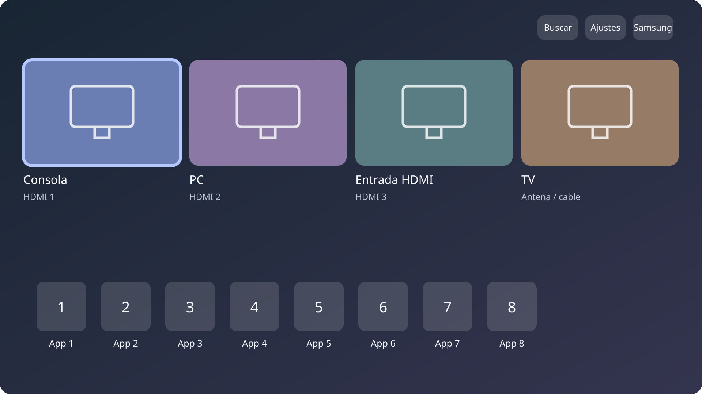

# Tizen TV Home

Guía y código de **Quiet Home**, un launcher nativo para Samsung Tizen con apps, entradas HDMI, búsqueda y acceso a los ajustes del TV. Reúne el procedimiento que funcionó, los intentos que no dieron resultado y las comprobaciones necesarias para adaptar el trabajo a otro equipo sin empezar desde cero.

El caso probado es un **Samsung QN75QN70FAGCZB, Tizen 9, firmware T-PTMFUABC-0090-1301.0, ARMv7 y .NET 6**. La guía sirve como punto de partida para otros modelos; el código, las API privadas y las recetas de instalación todavía conservan supuestos de ese caso. La compatibilidad de otro equipo requiere su propia verificación.



*Esquema de la distribución del launcher. Usa nombres y tarjetas de ejemplo; no es una captura de un TV ni contiene un catálogo personal.*

## Qué se puede hacer

Con el mando, elegí una entrada y pulsá **OK** para cambiar de fuente, o bajá a las apps para abrir una. Mantené **OK** sobre una app para moverla, cambiarle el nombre u ocultarla. La lupa abre la búsqueda de la tienda; la casa permite volver al Inicio Samsung.

El launcher obtiene las apps y las entradas del equipo, conserva la escena al regresar y actualiza el catálogo en segundo plano. Ocultar una app solo cambia esta interfaz. Los ajustes nativos, la instalación desde la tienda y la reproducción siguen a cargo de Samsung.

## Por dónde empezar

| Tu situación | Recorrido |
|---|---|
| Querés entender el método o tenés otro modelo/firmware | Empezá por [adaptar a otros televisores](docs/adapting-other-tvs.md). Incluye un inventario y los puntos del código que hay que revisar. |
| Tenés el modelo y firmware del caso probado | Revisá [compatibilidad y acceso](docs/compatibility.md), luego [compilación e instalación de prueba](docs/installation.md). También necesitás comprobar tus originales. |
| El launcher ya funciona al abrirlo manualmente | Seguí [asignar el botón Home](docs/home-button.md) y [personalización](docs/customization.md). |
| Algo falló o querés volver al estado anterior | Usá [recuperación](docs/recovery.md) y los respaldos de tu propio equipo. |

La secuencia es: **inventario → acceso comprobado → originales e inversa → compilación → prueba manual → botón Home → reinicio y standby**. El generador de planes se limita al perfil revisado y no conecta al TV. Cambiar el nombre de un perfil no adapta las API, los scripts ni las rutas del código.

## Lo aprendido en el TV probado

- Mantener la escena y sacar la consulta de apps del hilo de interfaz evitó reconstrucciones innecesarias. No se midió una mejora general de FPS.
- Una DLL nueva en disco podía coexistir con código anterior todavía cargado. Un reinicio normal permitió comprobar qué versión se ejecutaba.
- La operación `main`, `home_appid` y `startup_appid` son valores distintos: se reasignó Home y se conservó el arranque en TV.
- La guía de volumen, el regreso desde la tienda, el teclado y la escucha de voz requirieron revisiones específicas. Algunos cambios quedan fuera del instalador del launcher.

Los detalles y límites están en [verificación](docs/verification.md), [rendimiento](docs/performance.md), [regreso desde la tienda](docs/store-back.md), [teclado y voz](docs/keyboard-and-voice.md) y [privacidad](docs/privacy.md). La instalación completa desde este repositorio no se ensayó en un segundo TV de fábrica.

## Reproducir el trabajo con un agente de código

Podés clonar el repositorio y usar este pedido como punto de partida:

> Leé README.md, AGENTS.md y docs/adapting-other-tvs.md. Ayudame a adaptar Quiet Home a un TV que me pertenece. Primero registrá modelo, firmware, arquitectura, runtime, contenedor y API disponibles; comparalos con el caso QN70F. Conservá las funciones que uso y explicá qué diferencias requieren cambios de código. Guardá los originales y prepará una inversa antes de cada modificación. Probá el launcher manualmente antes de asignarle Home y verificá reinicio y standby por separado. Usá ejemplos locales sin subir mis datos ni los binarios de Samsung.

## Desarrollo local

Las herramientas Python usan la biblioteca estándar. La compilación necesita PowerShell, un SDK .NET capaz de compilar `net6.0` y seis referencias de Tizen obtenidas de un SDK autorizado o del equipo compatible. Las herramientas de parche opcionales usan .NET 8 y Mono.Cecil. SDB y el transporte root se obtienen por separado.

```powershell
git clone https://github.com/ErickRRB/tizen-tv-home.git
cd tizen-tv-home
python -m unittest discover -s tests -v
```

Los tests anteriores funcionan sin TV ni DLL de Samsung. Las pruebas de restauración necesitan un shell POSIX; en Windows usan Git Bash y se omiten si no está disponible. GitHub Actions ejecuta la suite en Linux. Para compilar e instalar, seguí la [guía de instalación](docs/installation.md); activar Developer Mode por sí solo no concede el acceso necesario para sustituir una app de sistema.

## Código y recursos compartidos

Este repositorio contiene código fuente, recursos redistribuibles y ejemplos. Los catálogos reales, fotos, direcciones de red, credenciales, resultados de sesiones, referencias de Samsung y respaldos deben permanecer en `.local/`, fuera de Git. El acceso root compatible y una recuperación preparada son necesarios para el método documentado; un restablecimiento de fábrica no garantiza restaurar los archivos de sistema sustituidos.

Quiet Home deriva de [Quiet Tizen](https://github.com/jss8649/quiet-tizen), con atribución a Free My TV y a Inter. Ver [LICENSE](LICENSE) y [NOTICE.md](NOTICE.md).
